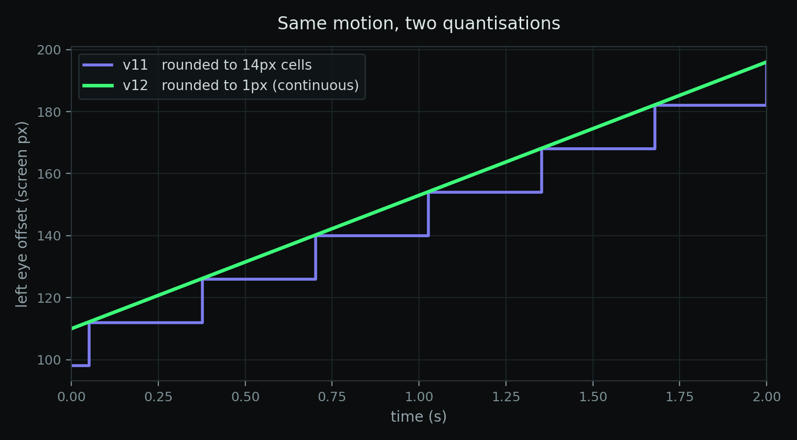
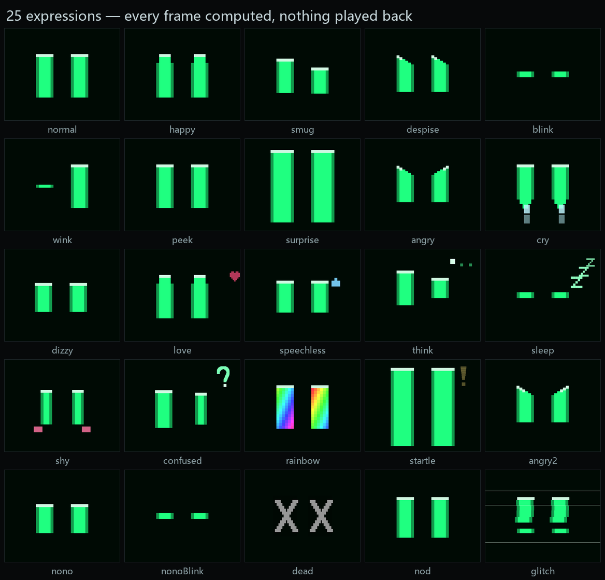
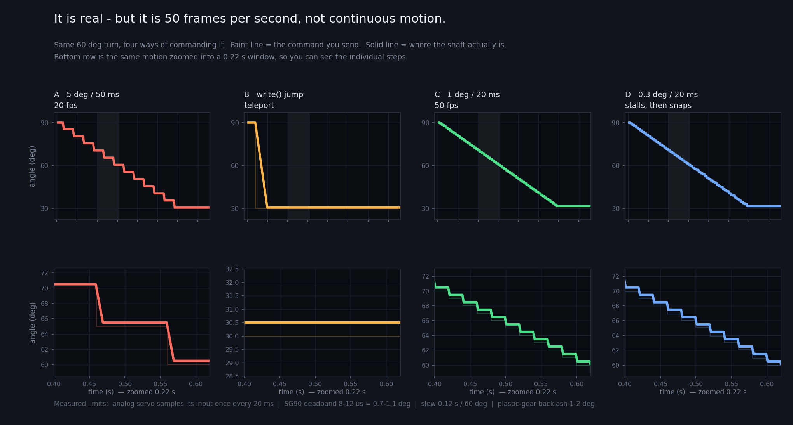

<div align="center">

<h1>Gloamind</h1>

<p><strong>Pixel eyes for small screens.</strong><br>
25 expressions, computed frame by frame — no sprite sheet, no pre-rendered GIF.</p>


<p><sub>One HTML file in a browser, or an ESP32-S3 driving a 1.8" ST7735S on a two-axis neck.</sub></p>

<p><a href="https://luka916.github.io/gloamind/web/eyes.html"><strong>▶ Run it live →</strong></a></p>

</div>

---

## What this is

Two green bars on a black screen. That is the whole idea.

What makes them read as alive is that nothing is played back. Every frame is computed from a
small amount of state: eyelid opening, pupil offset, breathing brightness, mood blending.
Because it is state and not a timeline, you can interrupt it at any point — pat it mid-blink
and it eases into a happy squint instead of finishing the blink and then cutting.

## Why it does not look like a robot

Three details. Each one is small, and leaving any of them out is visible immediately.

### 1. Positions resolve to 1 pixel, not to 1 cell

The drawing grid is 14px per cell, so the obvious implementation is `x = cell * 14`. That
quantises every movement to 14px and the eyes visibly hop.

The fix is to keep the grid, but multiply before rounding:

```js
x = Math.round((cell + dx) * P)
```

with the canvas scaled up from 160×128 to 560×448 so a single pixel is a small fraction of
the eye. Measured on 32 sample points during a pan: 3 of 32 showed movement before, 32 of 32 after.



### 2. Switching expressions never teleports

The eyes swing left and right while thinking. If you switch away mid-swing, the naive
implementation freezes the interpolated *pose* but drops the *swing phase*, so the eyes snap
back toward centre first — up to 2.5 cells, 35px on screen.

The fix is to bake the phase into the transition start point, so the new expression picks up
from wherever the eyes currently are:

```js
k = (1 - cos((frame - enterFrame) / 14)) / 2
```

The same bug exists for the peek animation. There the offset is stored separately
(`peekOff`) and the target is derived from the phase while the actual value follows
smoothly, so entering and leaving are both continuous.

### 3. Animation runs on elapsed time, not on frame count

`dt = 1000/60` looks harmless until the page runs on a 120Hz display, where everything is
twice as fast. Reading the real interval between frames makes the speed identical everywhere.

## 25 expressions



Rendered straight out of `web/eyes.html` — the sheet is generated by
`tests/gen_sheets.py`, so it cannot drift from the code.

`nono`, `nonoBlink` and `nod` are mostly *motion*: a still frame of them is almost
indistinguishable from `normal`. That is not a bug in the sheet, it is the honest limit of a
screenshot.

Two tiers, and the distinction matters: an idle expression may rotate on its own, a triggered
one only fires on a real event and never plays at random.

| Idle | | Triggered | Fires on |
|---|---|---|---|
| `normal` | resting | `surprise` | sudden noise |
| `happy` | gentle rise | `startle` | a louder one |
| `smug` | one eye larger | `angry` / `angry2` | repeated pokes |
| `despise` | both slanted | `nono` / `nonoBlink` | being told off |
| `blink` | closed, one line | `cry` | left alone too long |
| `wink` | one eye shuts | `dizzy` | fast shaking |
| `peek` | the pair slides sideways | `love` | head pat |
| | | `speechless` | a question it cannot answer |
| | | `think` | received a command |
| | | `sleep` | idle for 5 minutes |
| | | `shy` | being stared at |
| | | `confused` | did not understand |
| | | `dead` | battery critical |
| | | `nod` | agreement |
| | | `glitch` | easter egg |
| | | `rainbow` | easter egg |

Plus twelve gaze directions, so the eyes can look away from centre.

## The neck: why it looks *at* things

Everything above makes a face. This is what makes it a creature.

The vertical axis used to be frozen at 62° — it never looked up, never looked down. Now it
moves 43°–76° and spends about a quarter of its time above level, because a small robot on a
desk is *below* your eye level and up is where the interesting thing is.

Six parameters, each traced back to a measurement rather than a guess:


| Rule | Number | Source |
|---|---|---|
| eye lands first, head follows | 100–160ms (biology: 20–40ms, padded for servo inertia) | Bizzi 1971 |
| small targets move only the eye | head joins above ~7° | animal oculomotor range |
| duration scales with amplitude | `70 + 11 × cells` ms | saccadic main sequence |
| dwell time is skewed, not uniform | 0.7–2.4s, sum of three randoms | Henderson 1998, Dorr 2010 |
| straight ahead is weighted 8, others 1–4 | plus last-3-spots de-weighted ×3 | central bias + habituation |
| it breathes when idle | 1.2° sine, 4s period | — |

Full derivation, the literature table, and the measured before/after are in
[`docs/gaze-engine.md`](docs/gaze-engine.md).

The touch sensor gets a four-beat cascade rather than one animation: eyes snap to centre →
head lifts → happy squint → head returns 1.3s later. Run separately these are three unrelated
motions; in sequence they read as "it noticed you".

## Quick start

Download the repo and open [`web/eyes.html`](web/eyes.html). No build step, no dependencies,
no network access. It works from `file://`.

If you host it (GitHub Pages works), you can jump straight to one expression:

```
eyes.html?m=love
eyes.html?m=sleep&still=1
eyes.html?m=think&f=40&still=1
```

`still=1` locks the frame counter, which is what you want for screenshots. `f` picks the frame.

The left panel switches expressions manually; the right panel toggles individual decorations
(heart particles, Zzz, sweat drop, question mark) so you can see what each one contributes.

## On hardware (optional)

The `firmware/pet_eye` directory is a line-for-line port to C++ for an ESP32-S3 with an
ST7735S panel and two servos. Same maths, same shapes, same timing.

| Part | Model | Note |
|---|---|---|
| MCU | ESP32-S3 **N16R8** | needs the 8MB octal PSRAM variant |
| Panel | 1.8" 128×160 ST7735S | 8-pin SPI |
| Servos | 2 × SG90-class | pan and tilt, on their own 5V rail |
| Touch | TTP223 | one pad, on top of the head |

Wiring, calibration numbers, `TFT_eSPI` setup and the exact `User_Setup.h` changes are in
[`docs/pinout.md`](docs/pinout.md). Parts list in [`docs/bom.md`](docs/bom.md). How the neck is
driven — and why 1° per 20ms is the right step — is in
[`docs/servo-tuning.md`](docs/servo-tuning.md).

**Read [`docs/radio-survival.md`](docs/radio-survival.md) before you solder anything.** The
2.4GHz block is the one part of this board that dies permanently from a wiring mistake, and it
is also the part you cannot replace. It takes a capacitor, ten millimetres of spacing between
two joints, and five minutes with a multimeter — total cost under a dollar.



### Serial commands (115200, USB CDC)

| Command | Effect |
|---|---|
| `m <name\|index>` | switch expression |
| `d <0-12>` | gaze direction, clock face (0 = centre, 1 = 12 o'clock, 4 = 3 o'clock …) |
| `p <30-150>` | pan the neck |
| `t <23-118>` | tilt (62 = level, lower is up) |
| `p +1` / `t -1` | nudge one degree, **ignoring soft limits** — this is how you find the mechanical stops |
| `b <0\|1>` | auto-blink |
| `h <0-360>` `l <0.4-1.3>` | hue and brightness |
| `a <0\|1>` | autopilot on/off |
| `z` | release both servos (you can move the head by hand) |
| `c` / `c p\|t lo home hi` / `c s` | show limits / change limits / save |
| `f <0\|1>` | frame counter overlay |
| `i` | status: mood, gaze vector, pan, tilt, fps, heap, BLE state |
| `w` | RF check — scan for WiFi APs |
| `K` | clear the boot counter and retry Bluetooth after a reboot |

Over BLE it speaks the Nordic UART Service (`6e400001-…`), so any BLE serial terminal works —
the Android app *Serial Bluetooth Terminal* is the one used here.

## Things that broke

Collected here so nobody has to rediscover them.

| Symptom | Cause | Fix |
|---|---|---|
| Motion looks steppy | positions rounded to whole cells | round after multiplying by P, not before |
| Eyes jump when switching mood | interpolation frozen, swing phase lost | bake the phase into the transition start |
| Hearts and Zzz shrank | sizes written in raw pixels | multiply every hard-coded size by the scale factor |
| Animation speeds up on 120Hz | `dt` hard-coded to 16.67ms | read the real interval between frames |
| A phantom blink at boot | first frame `dt` covers setup time | reset `lastFrameMs` at the end of `setup()` |
| Torn image on the panel | SPI at 40MHz | drop to 27MHz; raise it only after it is stable |
| Colours inverted | blamed the address window | check `TFT_INVERSION_ON` and `TFT_BGR` instead |
| Servo does not move, code looks right | `ledcAttach` with a 16-bit resolution | the S3 tops out at **14 bits**; anything wider fails silently |
| Robot smiles at nothing | floating touch pin reads high | `INPUT_PULLDOWN` |
| Head only ever moved sideways | vertical axis had no driver at all | see `docs/gaze-engine.md` |
| Bluetooth dies, board reboots every 1.5s | 2.4GHz RF block failed; `init` returns OK, `enable` resets | [`docs/rf-module-failure.md`](docs/rf-module-failure.md) |
| Filesystem becomes read-only after crash loops | LittleFS dirty flag, repair does not clear it | keep small persistent flags in **NVS**, not the filesystem |

## Layout

```
web/eyes.html              the whole thing, single file
firmware/pet_eye/          ESP32-S3 port
shared/                    servo driver shared by the firmware
tests/                     renders the mood and gaze sheets from the HTML
docs/pinout.md             wiring, calibration, TFT_eSPI setup
docs/gaze-engine.md        why the neck moves the way it does
docs/servo-tuning.md       why the neck moves in 1° steps
docs/radio-survival.md     how not to kill the 2.4GHz block (read before soldering)
docs/rf-module-failure.md  post-mortem: a board that lost only its radio
docs/bom.md                parts list
docs/images/               demo, 25 expressions, 13 gaze directions, motion curve, servo traces
```

## License

MIT — use it, change it, sell it, just keep the notice.

Dependencies carry their own terms: TFT_eSPI (FreeBSD), Adafruit_NeoPixel (LGPL-3.0, only if
you use the LED ring), ESP32 Arduino core (Apache-2.0). The browser version has no dependencies
at all.
