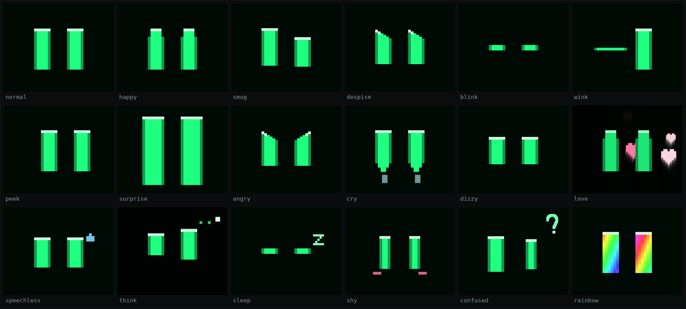

<div align="center">

<h1>Gloamind</h1>

<p><strong>Pixel eyes for small screens.</strong><br>
18 expressions, computed frame by frame — no sprite sheet, no pre-rendered GIF.</p>


<p><sub>One HTML file in a browser, or an ESP32-S3 driving a 1.8" ST7735S.</sub></p>

<p><a href="https://luka916.github.io/gloamind/web/eyes.html"><strong>▶ Run it live →</strong></a></p>

</div>

---

## What this is

Two green bars on a black screen. That is the whole idea.

What makes them read as alive is that nothing is played back. Every frame is computed from a
small amount of state: eyelid opening, pupil offset, breathing brightness, mood blending.
Because it is state and not a timeline, you can interrupt it at any point — pat it mid-blink
and it eases into a happy squint instead of finishing the blink and then cutting.

This repository is **the eyes only**. No body, no motors, no voice, no enclosure.

## Why it does not look like a robot

Three details. Each one is small, and leaving any of them out is visible immediately.

### 1. Positions resolve to 1 pixel, not to 1 cell

The drawing grid is 14px per cell, so the obvious implementation is `x = cell * 14`. That
quantises every movement to 14px and the eyes visibly hop.

The fix is to keep the grid, but multiply before rounding:

```js
x = Math.round((cell + dx) * P)
```

with the canvas scaled up from 160×128 to 560×448 so a single pixel is a small fraction of
the eye. Measured on 32 sample points during a pan: 3 of 32 showed movement before, 32 of 32 after.


### 2. Switching expressions never teleports

The eyes swing left and right while thinking. If you switch away mid-swing, the naive
implementation freezes the interpolated *pose* but drops the *swing phase*, so the eyes snap
back toward centre first — up to 2.5 cells, 35px on screen.

The fix is to bake the phase into the transition start point, so the new expression picks up
from wherever the eyes currently are:

```js
k = (1 - cos((frame - enterFrame) / 14)) / 2
```

The same bug exists for the peek animation. There the offset is stored separately
(`peekOff`) and the target is derived from the phase while the actual value follows
smoothly, so entering and leaving are both continuous.

### 3. Animation runs on elapsed time, not on frame count

`dt = 1000/60` looks harmless until the page runs on a 120Hz display, where everything is
twice as fast. Reading the real interval between frames makes the speed identical everywhere.

## 18 expressions



Two tiers, and the distinction matters: an idle expression may rotate on its own, a triggered
one only fires on a real event and never plays at random.

| Idle | | Triggered | Fires on |
|---|---|---|---|
| `normal` | resting | `surprise` | sudden noise |
| `happy` | gentle rise | `angry` | repeated pokes |
| `smug` | one eye larger | `cry` | left alone too long |
| `despise` | both slanted | `dizzy` | fast shaking |
| `blink` | closed, one line | `love` | head pat |
| `wink` | one eye shuts | `speechless` | a question it cannot answer |
| `peek` | the pair slides sideways | `think` | received a command |
| | | `sleep` | idle for 5 minutes |
| | | `shy` | being stared at |
| | | `confused` | did not understand |
| | | `rainbow` | easter egg |

Plus eight gaze directions, so the eyes can look away from centre.

## Quick start

Download the repo and open [`web/eyes.html`](web/eyes.html). No build step, no dependencies,
no network access. It works from `file://`.

If you host it (GitHub Pages works), you can jump straight to one expression:

```
eyes.html?m=love
eyes.html?m=sleep&still=1
eyes.html?m=think&f=40&still=1
```

`still=1` locks the frame counter, which is what you want for screenshots. `f` picks the frame.

The left panel switches expressions manually; the right panel toggles individual decorations
(heart particles, Zzz, sweat drop, question mark) so you can see what each one contributes.

## On hardware (optional)

The `firmware/pet_eye` directory is a line-for-line port to C++ for an ESP32-S3 with an
ST7735S panel. Same maths, same shapes, same timing — it exists to prove the eyes survive
contact with a real screen, not as a separate product.

| Part | Model | Note |
|---|---|---|
| MCU | ESP32-S3 **N16R8** | needs the 8MB PSRAM variant |
| Panel | 1.8" 128×160 ST7735S | 8-pin SPI |

Wiring, `TFT_eSPI` setup and the exact `User_Setup.h` changes are in
[`docs/pinout.md`](docs/pinout.md). Parts list in [`docs/bom.md`](docs/bom.md).

If you only want the eyes on a screen, that is one board and one panel. Nothing else.

Serial commands at 115200: `m <name|index>`, `d <0-8>`, `b <0|1>`, `h <0-360>`, `l <0.4-1.3>`, `i`.

## Things that broke

Collected here so nobody has to rediscover them.

| Symptom | Cause | Fix |
|---|---|---|
| Motion looks steppy | positions rounded to whole cells | round after multiplying by P, not before |
| Eyes jump when switching mood | interpolation frozen, swing phase lost | bake the phase into the transition start |
| Hearts and Zzz shrank | sizes written in raw pixels | multiply every hard-coded size by the scale factor |
| Animation speeds up on 120Hz | `dt` hard-coded to 16.67ms | read the real interval between frames |
| A phantom blink at boot | first frame `dt` covers setup time | reset `lastFrameMs` at the end of `setup()` |
| Torn image on the panel | SPI at 40MHz | drop to 27MHz; raise it only after it is stable |
| Colours inverted | blamed the address window | check `TFT_INVERSION_ON` and `TFT_BGR` instead |

## Layout

```
web/eyes.html          the whole thing, single file
firmware/pet_eye/      ESP32-S3 port (optional)
docs/pinout.md         wiring and TFT_eSPI setup
docs/bom.md            parts list
docs/images/           demo, expression grid, motion curve
```

## License

MIT — use it, change it, sell it, just keep the notice.

Dependencies carry their own terms: TFT_eSPI (FreeBSD), Adafruit_NeoPixel (LGPL-3.0, only if
you use the LED ring), ESP32 Arduino core (Apache-2.0). The browser version has no dependencies
at all.
