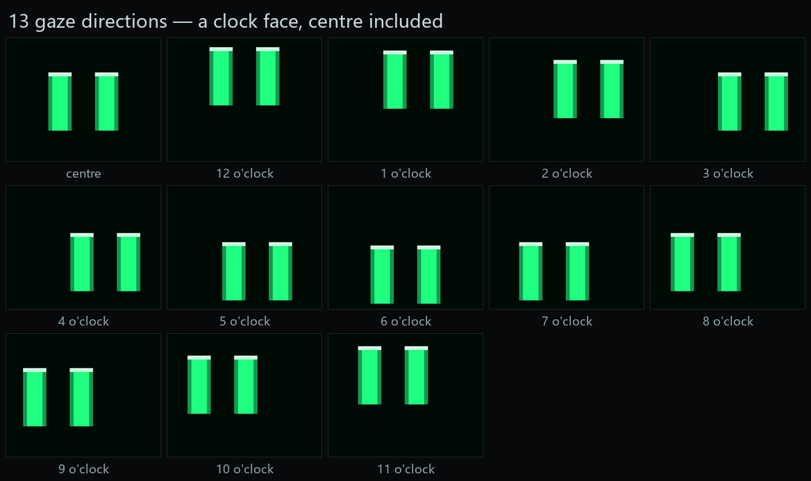

# Making the eyes look *at* something

The eyes on their own read as a face. They do not read as a creature. The difference is
whether the gaze looks *directed* — and that turned out to be six small parameters, not a
smarter animation.

Before this work the vertical axis was **frozen at 62°**. It never looked up, never looked
down. After: it moves between 43° and 76°, and spends about a quarter of its time above level.

## Where the numbers come from

Nothing here was invented. Each parameter traces back to a measurement.

| Source | What it measured | What we took from it |
|---|---|---|
| Blakemore & Donaghy 1980 (cat, *J Physiol* 300:317) | saccades over 4° almost always trigger a head turn; the head lags the eye by **~30ms** most often; the eye then rotates *back* to hold the target (compensation gain 0.96); 20° saccades peak at 250°/s, last 110ms, duration grows **2.1 ms/degree** | eye first, head after; head takes the eye with it and the eye must compensate |
| Bizzi et al. 1971 (macaque) | eye leads head by **20–40ms** on unpredictable targets; order reverses when the target is predictable | we use the unpredictable version |
| Wong 2014 / Bahill 1975 (saccadic main sequence) | peak velocity 30–700°/s, duration 30–100ms; ≤20° the velocity scales with amplitude and then saturates near 500°/s; latency 150–250ms | big movements must be *faster*, not the same speed as small ones |
| Henderson & Hollingworth 1998; Dorr et al. 2010 (human scene viewing) | fixation 240–330ms, mode 230ms, **right-skewed** (both very short and very long are rare); mean saccade 4.6°; **central bias** | dwell time must be random and skewed short; straight ahead gets the most weight |
| Ott et al. 1998; Katzir & Rivlin (chameleon) | stop-and-go scanning; once locked, the *head* turns to the target and the eyes converge; a moving target is tracked with the head, not the eyes | a believable fixation involves the head; let the head do the big moves |

What we could not support, we did not implement. Dogs tilt their head when localising a sound,
but that is a roll about the line of sight — we have no roll axis, so there is no honest way
to fake it.

## The six rules

### 1. Eye first, head ~100–160ms later

Biology says 20–40ms. A hobby servo has inertia that a eye muscle does not, so 20ms would just
look like they move together. 100–160ms reads as deliberate: the eye *flicks*, the head
*arrives*. That gap is the whole difference between "looking" and "turning".

### 2. Small targets move the eye only; large ones bring the head

In an animal the eye covers roughly ±30° and the head takes over beyond that. Inverted for a
screen: the eye can be drawn pointing anywhere, so small offsets move only the pupil and save
the servo. This is also why it stops looking mechanical — the body responds proportionally
instead of to every twitch.

### 3. Duration scales with amplitude

```c
duration_ms = 70 + 11 * amplitude_in_cells
```

A small glance is 81ms; a large swing is 136ms. Everything used to take a flat 260ms, which
made large and small movements feel identical — the single biggest reason the motion looked
fake.

### 4. Half the ticks do nothing

This is the rule that was missing, and it is the one that mattered most.

There is a timer. When it fires, the first thing that happens is a coin flip: **50% of the time
the correct action is no action at all**, and the timer simply extends. There is nothing to look
at, so it keeps looking where it was looking.

A creature that changes target every second is not alert, it is a random number generator with a
servo attached. Attention is mostly *not* moving.

### 5. Walk along the clock face; never teleport

The first attempt at "calm" kept the nine-spot interest table and just biased the choice toward
nearby spots. It measured **3.27 clock steps per movement** — because nine spots on a twelve
position ring means the neighbouring position often has no spot at all, so every jump was forced
to be a long one. It still looked like teleporting.

The fix was to stop choosing among spots. The gaze now **walks the ring one 30° step at a time**,
and at each step it picks clockwise or anticlockwise with probability proportional to how
worthwhile the destination is:

```
12 o'clock  6     3 o'clock  3     5, 7 o'clock  1
 1, 11      5     4, 8       2     6 o'clock     1
 2, 10      4     9 o'clock  3
```

So it drifts toward the upper half by itself — that is where a person is, if you are a robot the
size of a hand — without a rule that forbids looking down. Measured after the change: **1.56
steps per movement**, most of them a single step.

Separately, about 8% of movements go back to dead centre. That is the one deliberate, purposeful
move in the whole engine: nothing is happening, so it checks whether you are still there. It also
solves a geometry problem — the ring walk can never reach position 0, so without this the eyes
would sit permanently 30° off-centre.

The first implementation of this had a bug worth recording: the guard was written as `r < 58`
after a `r < 34` early-return, which is not 8% but **24%** of all saccades. The neck was being
dragged back to straight ahead once every few seconds, and because that was also the last thing
to happen before the drowsy threshold, the robot reliably fell asleep facing exactly forward —
sitting to attention instead of slumped. Two fixes: the threshold moved to `r < 42`, and the
re-centring move is suppressed entirely after 60 s without interaction. Measured afterwards,
`pan` is non-zero in 85% of samples and sleep lands at `pan=13` rather than `pan=0`.

### 6. Breathe, even when idle

A servo holding still is obviously a servo. A 1.2° sine at a 4-second period is invisible as
motion, but the head is never a rock.

## The interest map



Thirteen discrete directions, generated from `web/eyes.html` by `tests/gen_sheets.py`.
Looking down (`6 o'clock`) pushes the eyes to the bottom edge of the 160×128 panel and they
clip there — that is what the panel does, not an artefact of the screenshot. On hardware the
firmware keeps the tilt offset inside the calibrated servo range, so the clip is only visible
in the browser.

| Direction | Weight | Pan / tilt offset |
|---|---|---|
| centre (you) | 6 | 0 / 0 |
| 12 o'clock (straight up) | 6 | 0 / **−24°** |
| 1, 11 o'clock | 5 | ±13 / −10 |
| 2, 10 o'clock | 4 | ±22 / −6 |
| 3, 9 o'clock | 3 | ±26 / 0 |
| 4, 8 o'clock | 2 | ±22 / +6 |
| 5, 7 o'clock | 1 | ±13 / +10 |
| 6 o'clock (the desk) | 1 | 0 / +12 |

The head offsets are derived from the direction vector rather than typed in per spot:
`pan = x·26`, `tilt = y·12`, with straight-up getting an extra push (−24°) because a small robot
on a desk has to look *up* to see a face.

Looking up still outweighs looking down heavily — not by a rule, but because the walk's weights
make the upper half four to six times more likely to be stepped into.

## The touch cascade

One pat becomes four beats, in order, and the ordering is what sells it:

```
1. eyes snap back to centre        90ms    "it noticed"
2. head lifts 12°                          "it looked up at you"
3. happy squint                   220ms    "it liked it"
4. after 1.3s, head returns, autopilot resumes   "it is not clingy"
```

Run separately these are three unrelated animations. Run in sequence, they read as one
reaction. The touch pin only accepts a rising edge, with a 1.4s cooldown.

## Measured result

Three builds, same board, 70–90 seconds each, sampling `dir=` and `pan=` from `i` four times a
second (`tests/gaze_rhythm.py`):

| | first attempt (nearby-biased spots) | after walk-the-ring | after the rest rule |
|---|---|---|---|
| gaze changes per minute | 9.4 | 7.2 | **3–4** |
| clock steps per change | **3.27** | 1.56 | 1–3, mostly 1 |
| pan span | 44° | 31° | 16–22° |
| mood changes per minute | 15.4 | 15.2 | **5–11** |

The version before any of this was worse than all three: a pick every ~1.5 s, uniform across all
nine spots, head moving every time, roughly **40 changes per minute averaging 3+ steps**.

What it does now, in words: it looks at you, mostly. Every 15–25 seconds it glances about 30° to
one side and comes back. Twice a minute it drifts two steps. Three times an hour it goes
somewhere else entirely. Between all of that it is completely still, and that is the point.

| | Before | After |
|---|---|---|
| Vertical axis | constant 62°, never moved | moves when the gaze crosses two steps |
| Ordering | eye and head moved independently | eye lands, head follows 100–160ms later |
| Small saccades | head moved anyway | eye only — under 4°, a cat does not move its head |
| Time between changes | ~1.5 s | 15–25 s |
| At rest | never at rest | still 50% of the time |

## Honest limitations

| Limit | Consequence | Fixable? |
|---|---|---|
| No roll axis | cannot do a real head tilt | needs a third servo |
| No camera | "what it is looking at" is a hard-coded table, not vision | an OV2640 would make it real |
| 12 discrete gaze directions | the eye only points at multiples of 30°, not continuously — which is also why the walk has to be stepwise | needs vector-based rendering |
| Fixed servo speed | large turns have no "throw" | needs amplitude-scaled PWM stepping |

The last row matters most, so it is worth saying plainly: **this looks like it has intent, it
does not have intent.** It appears to be paying attention because the rhythm, the ordering,
the habituation and the central bias are right — not because it can see.

## Where it lives in the code

| File | Contents |
|---|---|
| `firmware/pet_eye/pet_eye.ino` | `DIR_W[]`, `dirToNeck()`, `gazePick()`, `handleTouch()` |
| same | deferred head motion (`g_neckPend` / `g_neckLag`), the breathing term |
| `PIN_TOUCH 13` | the pat sensor |
