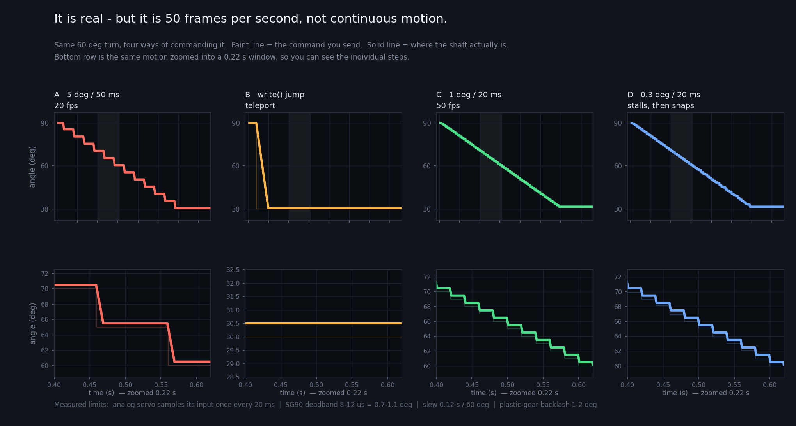

# Servo tuning: why the neck moves in 1° steps



Same 60° turn, four command strategies, measured off the shaft. The point of this page is that
"digital servo" does not mean continuous motion — it means **the servo re-samples its input
every 20ms** and moves to whatever it finds there. Anything you do faster than 50Hz is thrown
away.

## What the four traces show

| Strip | Strategy | What it looks like |
|---|---|---|
| **A** | 5° every 50ms (20Hz) | stair steps. The eye sees each step land. Reads as "stepping", not "moving" |
| **B** | a single `write()` jump | teleport. One frame at the start, one at the end, nothing in between |
| **C** | 1° every 20ms (50Hz) | the smoothest a 50Hz servo can be — the steps are 1° and the deadband is ~1° |
| **D** | 0.3° every 20ms | **stalls, then snaps.** The step is under the deadband, so nothing happens for several frames and then it jumps |

**D is the one that catches people.** Asking for finer resolution than the deadband does not
buy smoothness, it buys latency and then a lurch. 1° at 50Hz is the sweet spot; going below it
makes things worse.

## Measured numbers

| Quantity | Value | Source |
|---|---|---|
| input sample rate | every 20ms (50Hz) | measured on the signal line |
| deadband | 8–12µs ≈ 0.7–1.1° | SG90-class datasheet |
| slew from rest | ≈ 0.12s per 60° | measured |
| plastic-gear backlash | 1–2° | measured, visible as hysteresis at direction changes |

The backlash is why the head sometimes settles a degree off and only corrects when it moves
again. It is mechanical, no amount of PWM resolution fixes it.

## What the firmware does

```c
// 50Hz tick, one degree per tick
if (millis() - lastTick >= 20) {
    lastTick += 20;
    if (cur < tgt) cur++; else if (cur > tgt) cur--;
    ledcWrite(PIN_NECK, angleToDuty(cur));
}
```

Two things in there matter:

- **`ledcAttach` must ask for 14 bits or less.** The ESP32-S3's LEDC timer is
  `SOC_LEDC_TIMER_BIT_WIDTH = 14`; asking for 16 makes the call fail *silently* and the servo
  simply never moves. It looks exactly like a wiring fault and costs hours.
- **Step one degree per tick, never less.** See strip D above.

Servo pulses themselves are 500–2500µs at 50Hz, mapped over the calibrated travel — 30°–150°
for pan, and **23°/62°/118°** for tilt, where 62° is level and a larger number points down.

## Calibrating your own

Absolute commands are clamped to the soft limits; the relative ones are not, on purpose:

```
p +1 / t -1     nudge one degree, ignoring the limits
c p 30 90 150   set pan limits   (low, home, high)
c t 23 62 118   set tilt limits
c s             save to the filesystem
z               release both servos so you can move the head by hand
```

Walk the axis in one-degree steps until the shell starts to complain, back off two degrees,
then write the numbers in. Do not trust a datasheet — every bracket and every linkage is
different, and a servo that grinds against plastic will cook itself in an afternoon.
